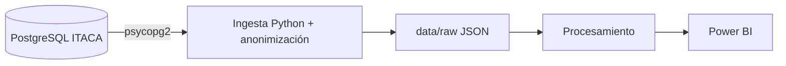

# Proyecto 2 · Analítica académica ITACA (origen relacional)

## Descripción y objetivo

Objetivo: el mismo dashboard de análisis académico en Power BI que el Proyecto 1, pero partiendo de una fuente de datos relacional en lugar de documental — practicar el pipeline completo con el otro paradigma de origen de datos habitual en proyectos reales.

## Arquitectura



## Fuentes de datos

Uso los dumps SQL de ejemplo de ITACA del zip que nos dio el profesor en la web del centro (CIPFP Mislata, cursos 2021-22 a 2025-26), cargados en un PostgreSQL en Docker (BD `itaca`, puerto 5432).

- **Acceso:** conexión desde Python con `psycopg2` (el equivalente a JDBC), un `SELECT` por tabla.
- **Credenciales:** usuario `lectura_bigdata` con permiso solo de `SELECT` sobre las 4 tablas. Los datos de conexión van en `.env`, que no se sube (plantilla en `.env.example`). El usuario se crea con [`SQL/preparacion_bd.sql`](SQL/preparacion_bd.sql).
- **Frecuencia:** alumnos, cursos y contenidos cambian una vez al año (matrícula); calificaciones, tras cada evaluación.

| Tabla | Campos (columna en la BD si cambia el nombre) |
|---|---|
| alumnos | anyo, nia, curso, turno, grupo |
| contenidos | anyo, curso, modulo (`codigo`), nombre_modulo (`nombre_cas`) |
| calificaciones | anyo, nia (`alumno`), curso, modulo (`contenido`), nota (`nota_numerica`), evaluacion |
| cursos | anyo, codigo, nombre_cas, padre |

## Bitácora de prácticas

### Bloque 1 · P2 — Ingesta ITACA desde BD relacional

**Qué he hecho:**
1. Revisé la BD y vi que los módulos están en la tabla `contenidos` y que algunos campos tienen otro nombre (`alumno` es el NIA, `contenido` es el módulo...). Trabajo con las 4 tablas del modelo (alumnos, contenidos, calificaciones y cursos); el "cinco tablas" del enunciado es una errata.
2. Creé el usuario `lectura_bigdata` de solo lectura. Lo probé: un `DELETE` da `InsufficientPrivilege`.
3. Preparé el entorno y el `.env` (copiando `.env.example` y poniendo la contraseña y el `NIA_SALT`).
4. Completé [`ingesta/ingesta_itaca_bd.py`](ingesta/ingesta_itaca_bd.py), que extrae las 4 tablas, anonimiza el NIA y guarda cada una en `data/raw/<tabla>_<fecha>.json`.

```bash
python3 -m venv .venv && source .venv/bin/activate
pip install psycopg2-binary python-dotenv pandas
python ingesta/ingesta_itaca_bd.py
```

**Resultado:** alumnos 7.193 filas, contenidos 1.688, calificaciones 106.814 y cursos 413. He comprobado que no queda ningún NIA real, que cada JSON tiene solo los campos del modelo y que las relaciones entre tablas cuadran (todo módulo de calificaciones existe en contenidos y todo curso existe en cursos).


**Decisiones:**
- **Solo extraigo los campos del modelo** (`SELECT columna AS campo`) en vez de `SELECT *`. Así el nombre, DNI, email, etc. del alumnado ni siquiera salen de la BD.
- **El NIA lo anonimizo con HMAC-SHA256 y una clave secreta** (`NIA_SALT` en `.env`). Con un SHA-256 normal, al ser solo 8 dígitos, se podría sacar el NIA original probando todos los números.
- **El hash se calcula una vez por NIA y se reutiliza**, así el mismo alumno tiene el mismo identificador en alumnos y calificaciones. Para comprobarlo, cuento las calificaciones sin alumno: salen 188 tanto en raw como en la BD original.
- **En raw no limpio nada.** Hay 188 calificaciones de alumnos que no están en `alumnos` y algunas filas duplicadas; eso viene así de origen y lo trataré en el procesamiento.
- **No subo a Git** los dumps del profesor ni `data/raw/`, porque llevan datos personales.
